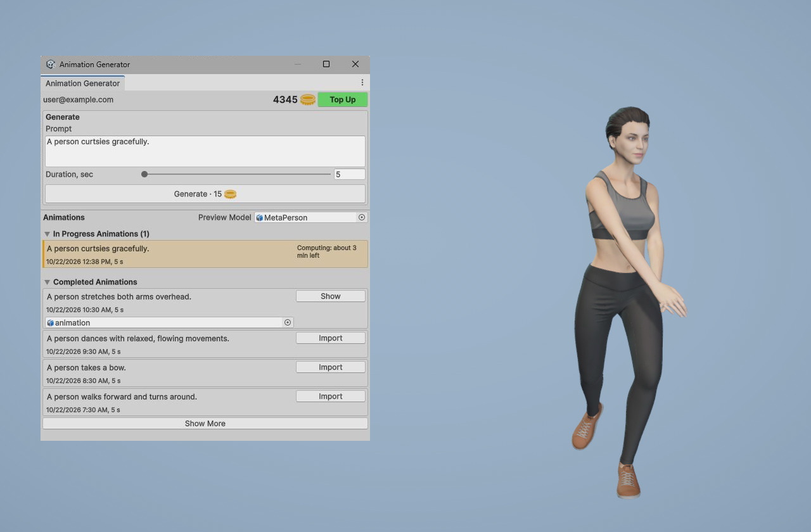
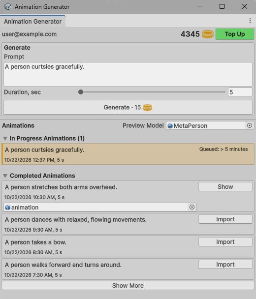
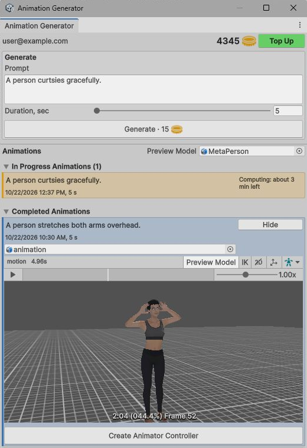
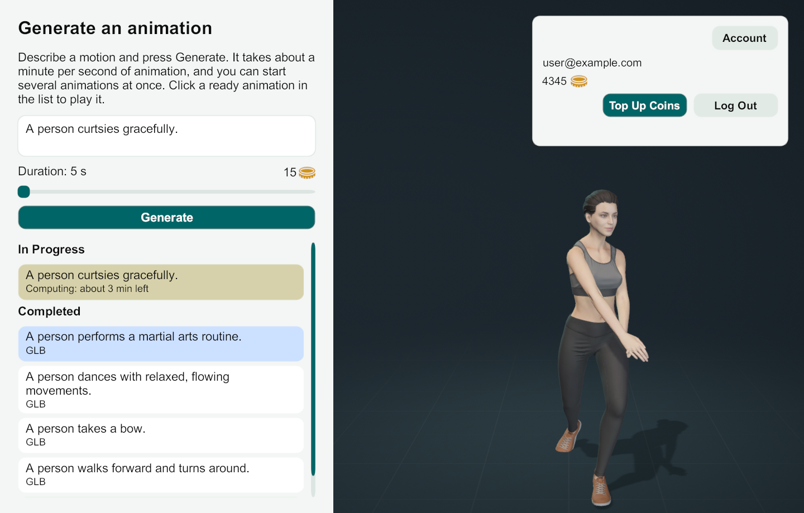
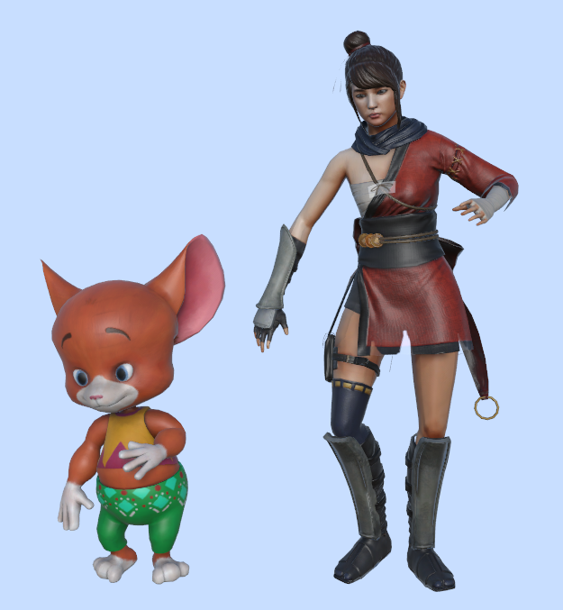

# Avatar SDK Move Unity Plugin: Setup and API

> Install and use the Avatar SDK Move Unity plugin: generate Humanoid animations from a text prompt in the Unity Editor and at runtime, with retargeting onto any humanoid model.

# Move Unity plugin

The Avatar SDK Move Unity plugin generates animations from a text description inside Unity. In the
Editor you build a library of clips as project assets; at runtime your application can generate
animations on demand, so the people using your app can describe the movement they want and watch it
play.

For an overview of the technology and the web editor, see [Avatar SDK Move](/move). Product details, licensing and the latest release notes live on the [Move Unity plugin page](https://avatarsdk.com/move-unity-plugin/) at avatarsdk.com.

## Installation

1. [Download the plugin](https://releases.avatarsdk.com/move/unity/avatar_sdk_move_1.0.0.unitypackage)
   and import the `.unitypackage` into your project.
2. The Account window opens automatically. Enter your email, then the one-time code you receive.
   It is the same account you use in [MetaPerson Creator](https://metaperson.avatarsdk.com).
3. Open one of the included sample scenes — one shows the Editor workflow, the other end-to-end
   runtime generation driven from a UI.

The plugin checks for updates when Unity starts and offers to download a newer version. You can also
check at any time with **Avatar SDK Move → Check for Updates**. Before importing a newer version,
delete `Assets/itSeez3D/AvatarSDKMove`; your generated animations live outside that folder and are
kept.

## Your first animation in the Editor

1. Open **Avatar SDK Move → Animation Generator**.
2. Type what you want your character to do and choose the duration, from 5 to 10 seconds.
3. Press **Generate**.
4. When the animation is ready, press **Show** to play it on your model.



Generation runs in the cloud and takes a few minutes. The animation appears under
**In Progress Animations** with an estimate of the time left, so you can keep working or start the next
one in the meantime. When it is ready, it is imported into your project automatically as a Humanoid
FBX, under `Assets/itSeez3D/AvatarSDKMoveData/GeneratedAnimations/`.

**Completed Animations** lists every animation on your account, including those generated in another
project. **Import** downloads one into this project; **Show More** loads older ones.



To preview a clip, assign a humanoid model from your scene as the **Preview Model** and press **Show**
on an imported animation. If you want it wired up, **Create Animator Controller** builds a controller
from the clip and assigns it to your character.

If a generation fails, it stays in the list with its animation code — send the code to
[support@avatarsdk.com](mailto:support@avatarsdk.com).



## Generating animations at runtime

Add the `AnimationGenerator` prefab to the scene and call `Generate`:

```csharp
// targetModel — a GameObject with an Animator whose Avatar is Humanoid
// prompt      — plain-text description of the movement
// duration    — requested animation length in seconds, from 5 to 10
await animationGenerator.Generate(targetModel, prompt, duration);
```

The call starts the generation, waits for it to finish and plays the result on your character.
Because generation takes a few minutes, you can also split it in two:

```csharp
TextToAnimationData animation = await animationGenerator.StartGeneration(prompt, duration);
// ...later, once the animation is completed:
await animationGenerator.Play(targetModel, animation);
```

`StartGeneration` returns as soon as the generation is started, so your UI stays free while it runs
in the cloud. Progress, completion and failure are also reported through the `onProgress`,
`onCompleted` and `onFailed` events of `AnimationGenerator`, which you can wire to UI in the Inspector.

Nothing is written to disk: at runtime the animation is delivered as GLB, parsed in memory and applied
to the character directly, which is why the same code path also works in a WebGL build where file
system access is unavailable.

The users of your app sign in with their own email and a one-time code. The runtime sample includes a
ready-made `AccountPanel` prefab for that, and
keeps a history of the user's animations: generations in progress survive restarting the app, and
clicking a completed animation plays it.



## Retargeting

Bones are resolved through Unity's `HumanBodyBones` mapping, so the plugin does not depend on your
skeleton's naming convention — the only requirement is that the model's Avatar is configured as
Humanoid and valid.

Rotations are applied as a delta from each bone's rest pose rather than copied absolutely. Skeletons
whose rest orientation differs from the source therefore keep their intended pose instead of
snapping to the source rig. Root motion is scaled by the ratio of hip heights between the source and
your character, so translation distance stays proportional to the character's size.

If a generated clip looks wrong on your model, check the Avatar configuration first: an unmapped or
mis-mapped bone in the Humanoid rig is the usual cause.



## Requirements and platforms

- **Unity version:** Unity 6000.0 or newer.
- **Render pipeline:** the plugin's scripts work with any render pipeline; the bundled sample models
  use URP materials.
- **Supported platforms:** Windows, macOS, Linux, WebGL, Android and iOS.

## Notes and limitations

**Model requirements.** Any model with a valid Humanoid Avatar works; MetaPerson sample characters
ship with the plugin so you have something to test against immediately. Generic and Legacy rigs are
not supported.

**Clip format differs by context.** In the Editor a clip arrives as FBX and is imported as a
standard Unity Humanoid `AnimationClip` — usable in Animator Controllers, Timeline and blend trees
like any other asset. At runtime it arrives as GLB and exists only in memory for that session; the
animation stays in the user's history, so it can be played again later.

**Shipping runtime generation.** Generation happens in the cloud, so a build that generates
animations at runtime needs network access, and each user signs in to their own account. Plan for
the failure path — no connection, or a generation that takes longer than your UI expects.

**Duration.** Animations are 5 to 10 seconds long, and longer animations take longer to generate.
