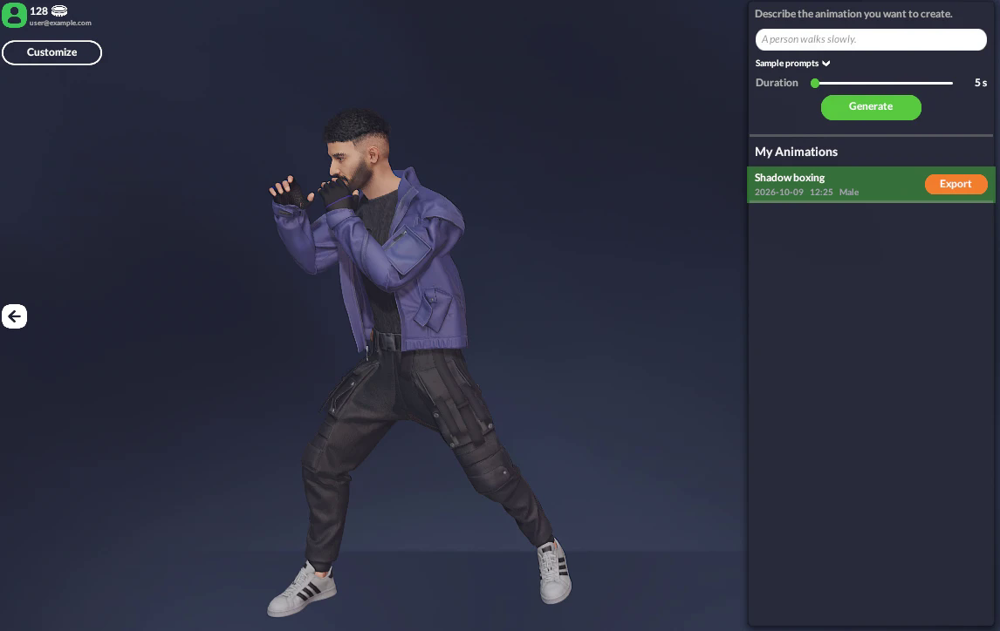

# Avatar SDK Move

Avatar SDK Move generates a 3D character animation from a text description. You type what the
character should do, the animation is generated in the cloud, and it arrives as a Humanoid clip
ready to play on your avatar. There is no motion capture, no suit, and no browsing through an
animation library for something close enough. In other words, Move is a text-to-motion
generator: the output is a 3D animation (FBX or GLB) for your character, not a video. Product
details and pricing are on the [text to 3D animation page](https://avatarsdk.com/move/).

<div class="iframe-container">
<iframe width="560" height="315" allow="fullscreen"
src="https://www.youtube.com/embed/EHR8vtuhUhA">
</iframe></div>

&nbsp;

Unlike the third-party services described in this section, Move is our own technology, so it works
with MetaPerson avatars without any conversion or retargeting setup on your side.

## Two ways to use it

**In the web editor.** Open [MetaPerson Creator](https://metaperson.avatarsdk.com), select your
avatar and describe the movement you want. The animation is generated and previewed on your own
avatar, and you can export it together with the model. See the
[Avatar SDK Move product page](https://avatarsdk.com/move/) for product details.



**In Unity.** The [Move Unity plugin](/move-unity-plugin) brings the same pipeline into the Unity
Editor and into your running application — see that page for installation, the Editor workflow and
the runtime API, and the [plugin page on avatarsdk.com](https://avatarsdk.com/move-unity-plugin/)
for product details and licensing. In the Editor
you build a library of clips as project assets; at runtime your application can generate
animations on demand, so the people using your app can describe the movement they want and watch
it play. Generation takes a few minutes.

```csharp
await animationGenerator.Generate(targetModel, prompt, duration);
```


## Works with any humanoid model

Move animates any character that Unity maps as Humanoid, so bone naming conventions do not matter.
Retargeting is not a naive rotation copy: each bone is transferred as a delta from its rest pose,
so proportions and skeleton orientations that differ from the source still read correctly. Root
motion is scaled to the character's hip height, which means a tall character and a short one both
travel a sensible distance.

In the Editor animations arrive as FBX and are imported as standard Unity Humanoid clips you can
use anywhere in your project — Animator Controllers, Timeline, blend trees. At runtime they are
delivered as GLB and applied directly to the character, which is what lets the whole flow run in a
WebGL build.

## Requirements

- Unity 6000.0 or newer
- Windows, macOS, Linux, WebGL, Android and iOS

## Common questions

**Is Move a text-to-motion tool?** Yes — text-to-motion and text-to-animation mean the same thing
here: a prompt goes in, a 3D character animation comes out. The result is a Humanoid clip you can
retarget, blend and edit, not a rendered video.

**Can I generate an animation from a text prompt for free?** Generation is paid (about a dollar per
5-second clip, billed from the same account balance in MetaPerson Creator and in the Unity plugin);
creating the MetaPerson avatar you animate is free.

**Does it work outside Unity?** Export FBX or GLB from MetaPerson Creator and use the clip in Unreal
Engine, Blender, three.js or Babylon.js. The Unity plugin delivers clips directly as Humanoid
animations; see [Mixamo animations](/mixamo) for combining generated clips with library ones.

For questions about Move, contact us at [support@avatarsdk.com](mailto:support@avatarsdk.com).
